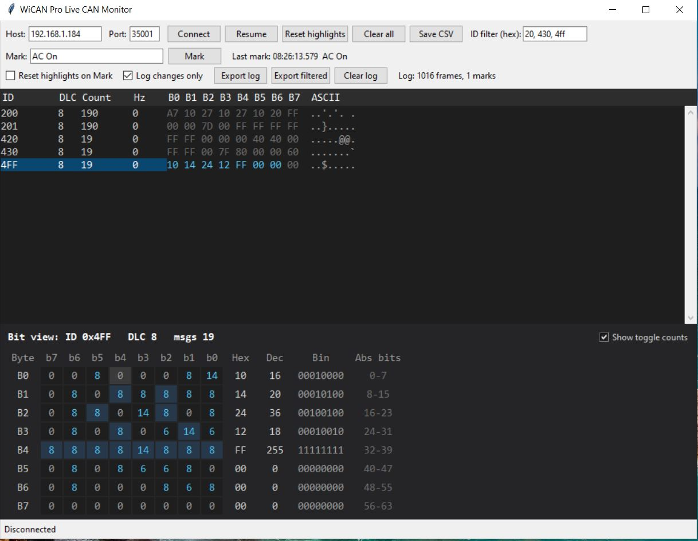

# WiCAN-Pro-Live-CAN-Monitor
CAN Monitor app for the WiCAN Pro over TCP to SLCAN

[Alt text](WiCAN-Monitor.JPG)

WiCAN Pro Live CAN Monitor
--------------------------
Windows desktop app (pure Python standard library: tkinter, no pip installs).
Connects to a WiCAN Pro running SLCAN over TCP and shows one row per CAN ID
with its latest 8 data bytes. Bytes that change are highlighted and fade out,
so you can see which byte reacts when you press a button / turn a knob.

BIT VIEW: click a row (or use the Up/Down arrow keys) to select an ID. The
panel at the bottom shows all 64 bits of that message, with the same change
highlighting per bit, plus optional per-bit toggle counters.

Colour legend (bytes and bits):
  orange (fading)  = changed in the last few seconds
  blue             = has changed at some point since last reset (dynamic)
  grey             = has NEVER changed since last reset (static)

Bit numbering in the bit view: each byte is shown MSB (7) on the left to
LSB (0) on the right. "Abs" bit number = byte*8 + bit (Intel/DBC style start bit).

MARKS AND LOG: type a label in the Mark box (e.g. "AC ON") and press the Mark
button (or Enter). The mark is timestamped and stored with the frame log.
"Export log" writes one CSV containing every logged frame and every mark in
time order. Columns: time, elapsed_s, event (FRAME or MARK), can_id, dlc,
data_hex, changed_bits, mark. changed_bits lists bits that differ from the
previous frame of that ID, as B<byte>.b<bit> (bit 0 = LSB), e.g. "B1.b3".
"Export filtered" does the same but keeps only the IDs in the ID filter box
(marks are always kept). The ID filter accepts several hex IDs separated by
commas or spaces, e.g. "215, 201"; the table shows the same IDs that the
filtered export writes.
By default only frames whose data changed are logged (small, easy to read);
untick "Log changes only" to log every frame.

Run:  python wican_monitor.py
